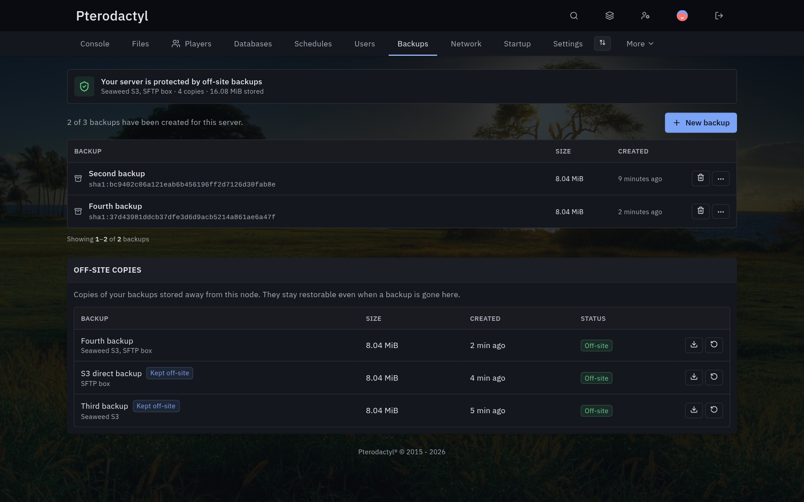
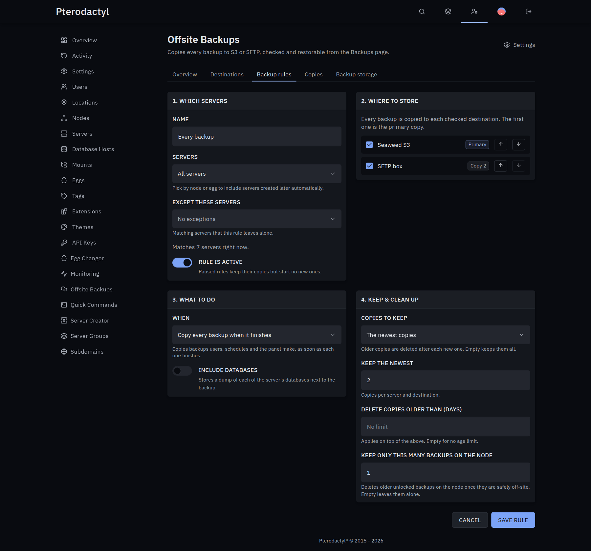

# Offsite Backups for Pterodactyl

Copies every backup to S3 or SFTP, deduplicated and checksum-verified, and restores it from the server's Backups page, even after the node is gone.

## Install

1. Download `offsite-backups-<version>.pteroext` from the [latest release](https://github.com/CCBlueX/Pterodactyl-Extension-Offsite-Backups/releases/latest).
2. Install and enable it under **Admin → Extensions**.
3. Add a destination and a rule under **Admin → Offsite Backups**. New backups are copied within a minute of finishing.

## Features

- **Destinations**: any S3-compatible storage (AWS, Cloudflare R2, Backblaze B2, Wasabi, Hetzner, OVH, MinIO) or SFTP. Plain `.tar.gz` per backup, or deduplicated so only changed data is stored. Optional encryption with your passphrase.
- **Rules**: copy every backup when it finishes, or create backups on a schedule. Pick servers by node, egg or name, keep the newest N or daily/weekly/monthly copies, drop old ones, keep only N local backups, skip idle servers, add database dumps.
- **Restore**: users restore or download off-site copies from the Backups page, including copies whose node backup is gone.
- **Per server**: backups on the node or directly in S3, off-site on/off, maximum copies and storage, also through the Application API.
- **Housekeeping**: failed copies retry, copies of deleted servers are removed after a grace period, deduplicated storage is pruned every night, Discord messages for the events you pick.

Transfers run in a background worker that the panel's scheduler starts every minute. To run it yourself instead, set **Transfer worker** to *Dedicated* and keep `php artisan offsite-backups:work` running. `php artisan offsite-backups:export <copy> <file>` writes a copy to a local file without Wings.
